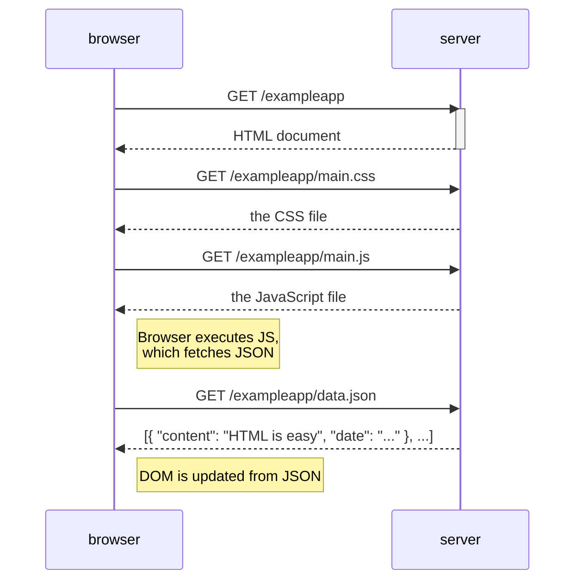
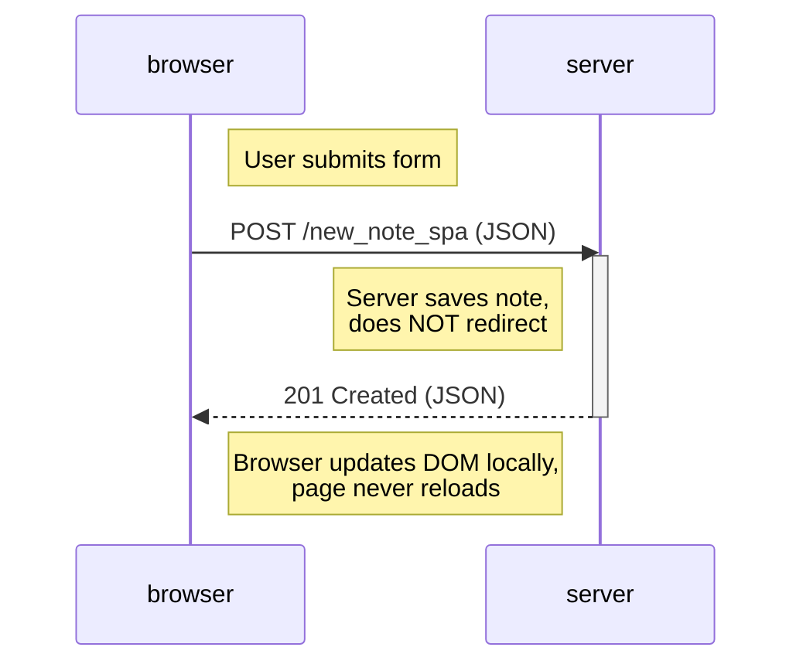

# Part 0 — Fundamentals of Web Apps

> Reference for the vocabulary, protocols, and architectural concepts that underpin every subsequent part.
> Assumes prior knowledge. Focus: mental model of how the web works, not tutorials.

## 📑 Index

1. [HTTP — The Transport Protocol](#1-http--the-transport-protocol)
2. [Sequence Diagrams (Mermaid)](#2-sequence-diagrams-mermaid)
3. [Traditional Web Applications](#3-traditional-web-applications)
4. [AJAX](#4-ajax)
5. [Single Page Applications (SPA)](#5-single-page-applications-spa)
6. [Forms: GET vs POST](#6-forms-get-vs-post)
7. [DOM & Browser APIs](#7-dom--browser-apis)
8. [Developer Console — Non-Negotiables](#8-developer-console--non-negotiables)
9. [Key Takeaways](#9-key-takeaways)

---

## 1. HTTP — The Transport Protocol

Every browser–server interaction is HTTP. The two fundamental request methods:

| Method   | Purpose                    | Body | Idempotent |
| -------- | -------------------------- | ---- | ---------- |
| **GET**  | Fetch a resource           | No   | Yes        |
| **POST** | Submit data / mutate state | Yes  | No         |

**Response anatomy:**

```http
HTTP/1.1 200 OK
Content-Type: application/json; charset=utf-8
Content-Length: 277

{ "id": 1, "content": "..." }
```

**Status code families:**

- `2xx` — success (`200 OK`, `201 Created`, `204 No Content`)
- `3xx` — redirection (`302 Found` — the classic post-redirect-get pattern)
- `4xx` — client error (`400 Bad Request`, `401 Unauthorized`, `404 Not Found`)
- `5xx` — server error (`500 Internal Server Error`)

**Headers that matter:**

- `Content-Type` — how to parse the body (`application/json`, `text/html`, `image/png`, …)
- `Content-Length` — size in bytes
- `Authorization` — credentials (used heavily in Parts 4–5)

**Golden rule:** the _Network_ tab of the browser DevTools shows exactly what was sent and received. This is the primary debugging surface for backend integration.

---

## 2. Sequence Diagrams (Mermaid)

GitHub renders Mermaid natively inside `.md` files. Use sequence diagrams to document any multi-step interaction — a POST+redirect, an AJAX fetch, an OAuth flow, etc.

**Syntax essentials:**



**When to draw one:**

- Documenting a non-trivial flow for the team.
- Explaining why a request appears multiple times in the Network tab.
- Writing a report or a README for a backend service.

---

## 3. Traditional Web Applications

**Model:** server generates full HTML on every navigation. The browser is a rendering terminal.

**Sequence:**

1. Browser requests a URL.
2. Server builds HTML (possibly from a template + DB query).
3. Browser receives HTML, requests assets (CSS, JS, images).
4. Browser renders. Any user action triggers a **full page reload**.

**Trade-offs:**

- ✅ Simple mental model, good for SEO, well-supported by any server-side framework (Django, Rails, Spring, Express+SSR).
- ❌ Every action reloads the page — wasted bandwidth, poor interactivity, state lost on reload.

---

## 4. AJAX

**Asynchronous JavaScript and XML** (2005 term; the "XML" part is legacy — JSON is standard today).

**Idea:** JavaScript running in the browser fetches data from the server **in the background** and updates the DOM **without a page reload**.

```js
// The canonical AJAX call — pre-fetch era
const xhr = new XMLHttpRequest();
xhr.onreadystatechange = function () {
  if (this.readyState === 4 && this.status === 200) {
    const data = JSON.parse(this.responseText);
    // update DOM
  }
};
xhr.open("GET", "/data.json", true);
xhr.send();
```

**Modern replacement — the Fetch API:**

```js
const response = await fetch("/data.json");
if (!response.ok) throw new Error("Failed to fetch");
const data = await response.json();
```

**Why it matters:** AJAX is the conceptual parent of every `useEffect(() => fetch(...))` you'll write in Parts 2+. Understanding the callback model (event-driven) explains why the modern Promise-based approach is clearer.

---

## 5. Single Page Applications (SPA)

**Idea:** the browser loads **one** HTML document plus a JavaScript bundle. All subsequent "pages" are rendered by JavaScript from data fetched via AJAX. The URL changes only via the History API — the server is never hit for a new page.

**Sequence for the classic SPA POST:**



**Contrast with traditional form POST:**

| Aspect         | Traditional                      | SPA                           |
| -------------- | -------------------------------- | ----------------------------- |
| Response       | `302 Found` + `Location:` header | `201`/`200` JSON              |
| Browser action | Full page reload                 | Nothing (JS handles it)       |
| URL change     | Server-driven                    | History API                   |
| State          | Lost on reload                   | Kept in memory / localStorage |

**Implications for architecture:**

- Server becomes a **pure data API** (REST/GraphQL).
- Frontend owns routing (React Router in Parts 5–7).
- Authentication moves to tokens (JWT in Parts 4–5) instead of server sessions.

---

## 6. Forms: GET vs POST

### Traditional form submission

**HTML:**

```html
<form action="/new_note" method="POST">
  <input name="note" />
  <button type="submit">save</button>
</form>
```

**Server-side route (Express):**

```js
app.post("/new_note", (req, res) => {
  notes.push({ content: req.body.note, date: new Date() });
  res.redirect("/notes"); // Post-Redirect-Get
});
```

**Browser behavior:** the server responds with `302`, the browser follows with a GET to `/notes`, and the full page reloads.

### SPA form submission

**Client-side handler prevents the default and does an AJAX POST:**

```js
form.onsubmit = (e) => {
  e.preventDefault();
  const note = { content: e.target.elements[0].value, date: new Date() };
  notes.push(note);
  e.target.elements[0].value = "";
  redrawNotes();
  sendToServer(note); // fire-and-forget POST
};
```

**Server just stores and returns the resource:**

```js
app.post("/new_note_spa", (req, res) => {
  notes.push(req.body);
  res.status(201).json(req.body);
});
```

**Rule of thumb:** if the browser is doing the rendering, use traditional forms. If JavaScript is doing the rendering, intercept the submit and use AJAX.

---

## 7. DOM & Browser APIs

**DOM (Document Object Model):** a tree representation of the HTML document, exposed by the browser as JavaScript objects. React's JSX compiles down to `document.createElement` calls.

**Essential DOM APIs (used under the hood by React):**

| API                                 | Purpose                       |
| ----------------------------------- | ----------------------------- |
| `document.getElementById(id)`       | Locate a node by id           |
| `document.createElement(tag)`       | Create an element             |
| `element.appendChild(child)`        | Attach a child                |
| `element.setAttribute(name, value)` | Set an HTML attribute         |
| `element.textContent`               | Set text content (XSS-safe)   |
| `element.innerHTML`                 | Set HTML content (⚠ XSS risk) |

**Why React exists:** these manual DOM manipulations don't scale — reconciling manual changes with state is error-prone. React's virtual DOM abstracts the process but ultimately calls the same DOM APIs.

**Inspecting the tree:** DevTools _Elements_ tab shows the live DOM; editing it is not persistent (server responses re-render on reload).

---

## 8. Developer Console — Non-Negotiables

**The First Rule of Web Development:**

> Keep the Developer Console open at all times.

**Tabs you will live in:**

| Tab             | Purpose                                                     |
| --------------- | ----------------------------------------------------------- |
| **Console**     | Logs, errors, uncaught exceptions — the first place to look |
| **Network**     | Every HTTP request/response, timing, headers, payload       |
| **Elements**    | Live DOM, applied CSS, computed styles                      |
| **Sources**     | Breakpoints, step debugging, `debugger` statements          |
| **Application** | localStorage, sessionStorage, cookies, service workers      |

**Practical habits:**

- Disable cache in Network tab when developing.
- Enable _Preserve log_ to keep entries across reloads.
- Check _Hide extension URLs_ to reduce noise.
- Reproduce bugs with the Network tab open _before_ touching code.

---

## 9. Key Takeaways

| Concept                                      | Why it matters later                            |
| -------------------------------------------- | ----------------------------------------------- |
| HTTP GET is safe & idempotent, POST is not   | REST API design (Part 3)                        |
| `Content-Type` determines parsing            | JSON vs form data (Parts 2–3)                   |
| AJAX decouples data fetching from page loads | Every `useEffect` + `fetch`/`axios` in Parts 2+ |
| SPA architecture: one HTML + JS bundle       | React Router, token auth (Parts 5–7)            |
| Forms: preventDefault + AJAX in SPAs         | Controlled inputs (Part 2)                      |
| DOM manipulation is verbose and error-prone  | Motivation for React (Part 1)                   |
| DevTools Network tab shows ground truth      | Debugging backend integration (Parts 2–4)       |
| Mermaid diagrams document sequences          | Exercise 0.4–0.6, future architecture docs      |

> _"The browser is the most hostile runtime environment you will ever deploy to — but DevTools makes it debuggable."_
